<div align="center">

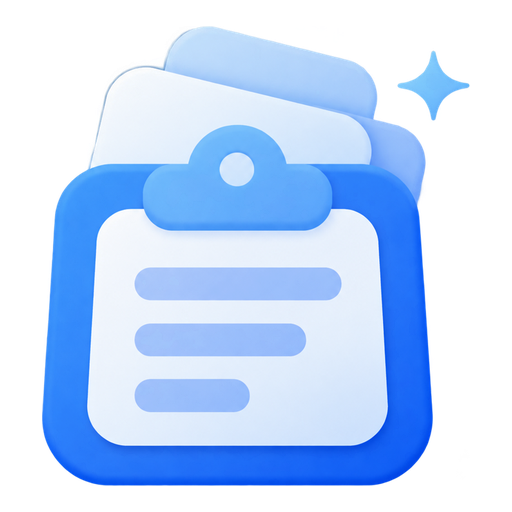

# 随贴 ClipDock

**给接了键盘的安卓平板，补上它一直缺的那个 Win + V。**

一款面向 **Android 平板 + 实体键盘** 的悬浮剪贴板历史管理器（Clipboard Manager）<br>
后台自动记录 · 快捷键唤起悬浮面板 · 看板娘悬浮球 · 多选合并粘贴 · 拆开挑选 · 变换后粘贴 · 文库 · 拼音搜索 · 完全离线


[](https://github.com/MistPeakLab/ClipDock/actions/workflows/build.yml)

[下载最新版](https://github.com/MistPeakLab/ClipDock/releases/latest) · [更新记录](CHANGELOG.md) · [English](#english)

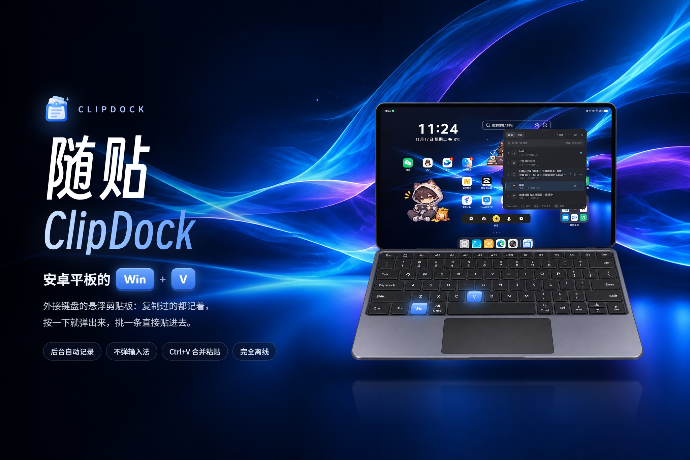

</div>

---

## 故事是这样的

你给平板配了蓝牙键盘，打字速度一下子回到了电脑时代。
直到你想粘贴**上一条**复制的内容——

Ctrl+V 只认最新的那一条。想要更早的，就得把输入法请出来，翻到剪贴板，再看它愿不愿意出来。
那块软键盘“哗”地升起来，把半个屏幕盖住。你明明有一把实体键盘，此刻却被迫回到手机的姿势。

Windows 早就有 Win + V，macOS 的剪贴板工具多得能开一条街，安卓平板这块地方却一直空着。

**随贴就是来填这块空地的。** 它安安静静待在后台，记下你复制过的每一段文字。需要时按一下 Win + V，面板浮出来，挑一条，回车，完事——输入框的光标还在原处，输入法一下都没动。

它不做云同步，不做 AI 改写，不做截图识别。**它只做剪贴板，并且努力把这一件事做好。**

---

## 悬浮面板：两个快捷键就够了

<p align="center">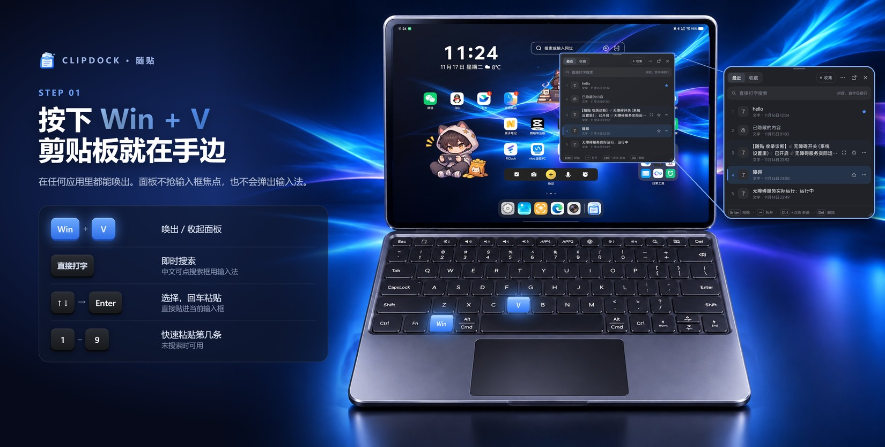</p>

<p align="center">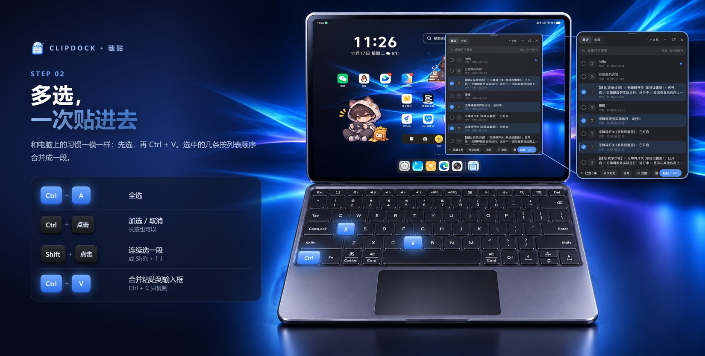</p>

### 长长一段，只贴你要的那几个字

复制了一整条快递短信，其实只想要运单号？在面板里按 `→`，这一条会**展开成全文**，像在 Word 里一样自由选择：拖动、双击选词、三击选段，`Ctrl + 拖动` 还能加选不相连的几段。按 `Enter`，就只贴选中的部分。

想先处理一下再贴，就点“变换”：去换行、改大小写、中英文之间加空格、提取数字 / 链接 / 邮箱……没效果的会变灰，提取类直接显示找到几个。原记录不动。

<table>
<tr>
<td width="50%" valign="top">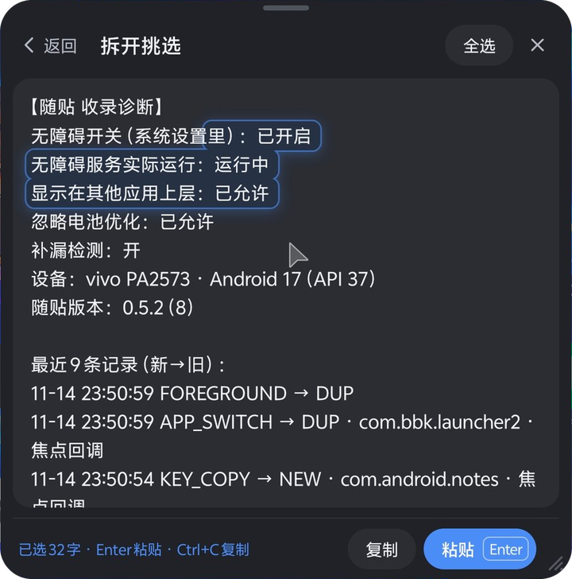</td>
<td width="50%" valign="top">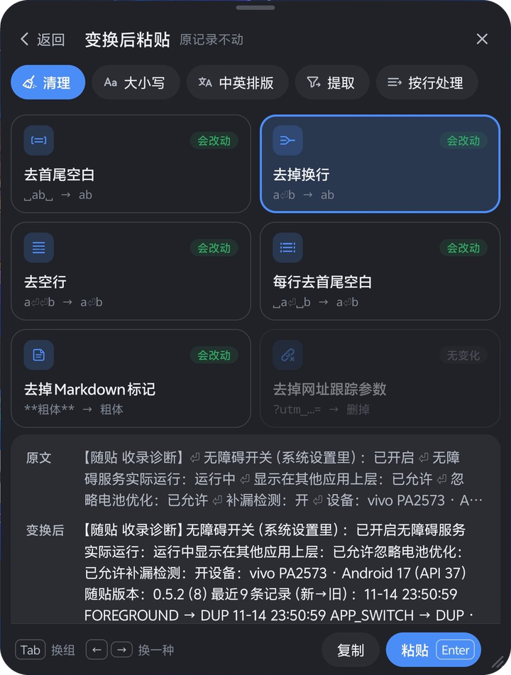</td>
</tr>
<tr>
<td align="center"><b>拆开挑选</b><br>网址、邮箱、电话、单号双击整块选中；触屏长按后拖手柄</td>
<td align="center"><b>变换后粘贴</b><br>19 种分 5 组，<code>Tab</code> 换组，<code>←</code> <code>→</code> 换一种，下方实时预览</td>
</tr>
</table>

<p align="center"><sub>以上都是平板上的实机截图（深色主题）。粘贴的那一刻，内容会变成一张小卡片飞进输入框的光标，不喜欢可以在设置里关掉。</sub></p>

<details>
<summary><b>面板快捷键一览</b></summary>

| 按键 | 作用 |
|---|---|
| `Win + V` | 唤出 / 收起面板（可改成任意组合键） |
| 直接打字 | 搜索（拼音、首字母都行；要打中文就点一下搜索框） |
| `↑` `↓` `Enter` / 点击 | 选择并粘贴 |
| `1` – `9` | 快速粘贴第几条（未搜索时） |
| `Tab` | 切换“最近 / 收藏” |
| `→` | 拆开挑选 |
| `Ctrl + A` | 全选 |
| `Ctrl + 点击` / 长按 | 加选 / 取消 |
| `Shift + 点击` / `Shift + ↑↓` | 连续选择一段 |
| `Ctrl + V` | 粘贴到输入框；选了多条就按列表顺序合并成一段 |
| `Ctrl + C` | 只复制，不粘贴 |
| `Ctrl + P` / `Delete` | 置顶 / 删除 |
| `Ctrl + Z` | 撤销刚删除的内容（删除后 5 秒内也可点屏幕上方的小条） |
| `Esc` | 取消选择 → 清空搜索 → 关闭 |

快捷键和电脑上的习惯一致：`Ctrl+V` 是“贴进去”，`Ctrl+C` 是“拿走”。增强模式下内容会直接粘进当前输入框，不用关掉面板再按一次。

</details>

<details>
<summary><b>拆开挑选的全部操作</b></summary>

| 操作 | 鼠标 / 触屏 | 键盘 |
|---|---|---|
| 展开一条 | 点这一行的 ⛶ | `→` |
| 放光标 / 自由选择 | 单击 / 拖动；触屏长按后拖动、拖手柄 | `←` `→` 逐字，`↑` `↓` 逐行，加 `Shift` 扩选 |
| 选词 / 选段 | 双击 / 三击（双击后接着拖，按词扩展） | `Ctrl + Shift + ←→` 按词扩选 |
| 行首行尾 / 全文首尾 | — | `Home` `End` / `Ctrl + Home` `Ctrl + End` |
| 加选不相连的几段 | `Ctrl + 拖动`；`Ctrl + 单击` 加选一句 | — |
| 全选 | 右上角“全选” | `Ctrl + A` |
| 粘贴 / 只复制 | 底部按钮 | `Enter` 或 `Ctrl + V` / `Ctrl + C` |
| 返回列表 | “返回” | `Esc`（先取消选择，再按一次返回）/ `Backspace` |

不相连的几段按原文顺序拼起来：原文中间隔着换行就换行，隔着空格就空一格。

</details>

---

## 主界面

浅色、深色跟随系统，也可以在 **我的 › 外观与语言** 里固定一种。

<table>
<tr>
<td width="50%">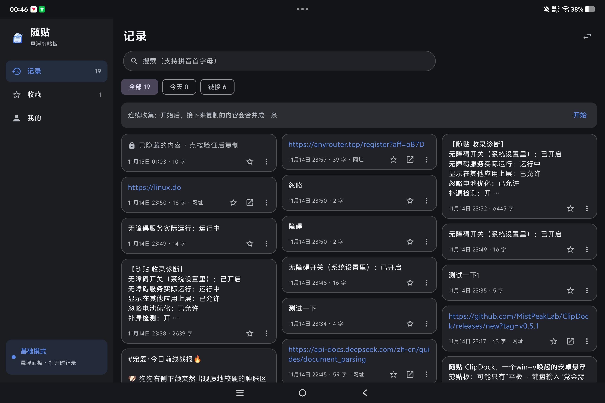</td>
<td width="50%">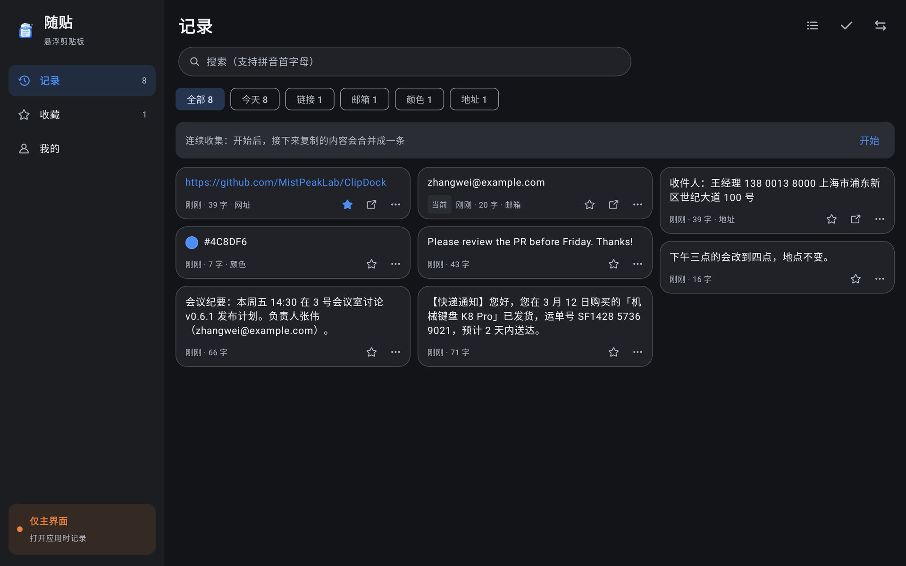</td>
</tr>
<tr>
<td align="center" colspan="2"><b>记录 / 收藏 / 我的</b>　卡片墙一眼扫过去；顶部按「今天 / 链接 / 类型 / 来源」筛选，拼音也能搜</td>
</tr>
<tr>
<td width="50%">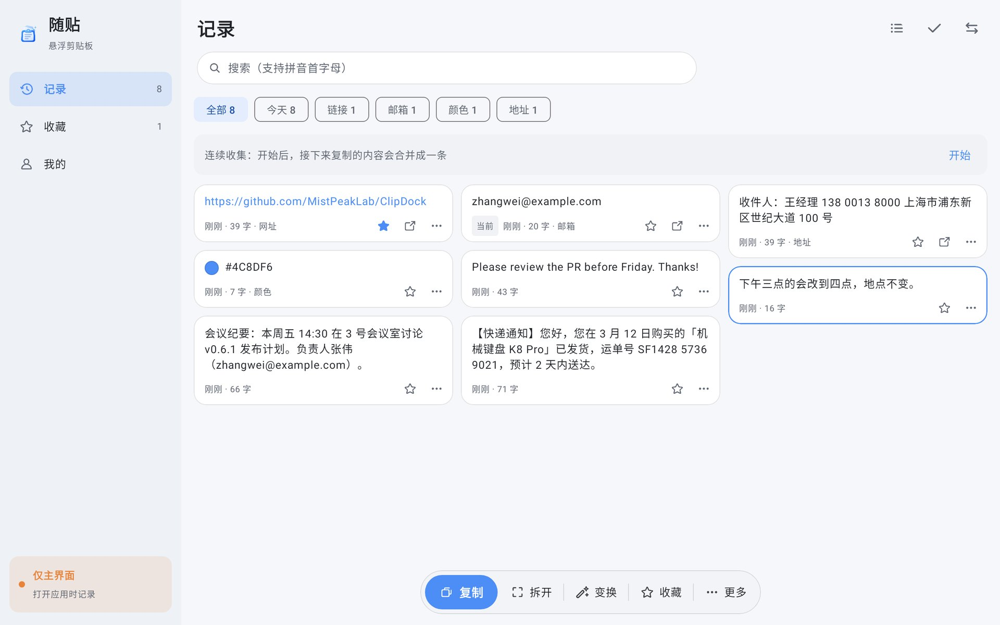</td>
<td width="50%">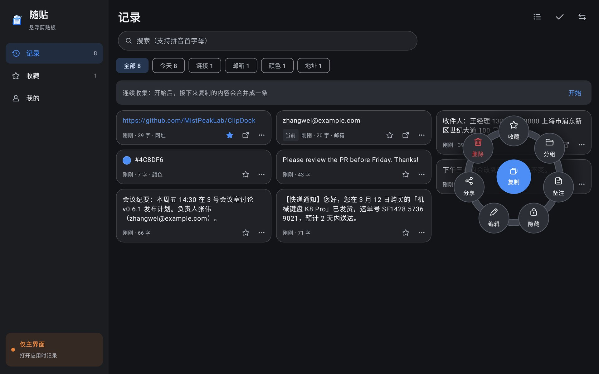</td>
</tr>
<tr>
<td align="center"><b>单击：动作条</b><br>管“用这条内容”：复制 / 拆开 / 变换 / 收藏 / 更多；双击直接复制</td>
<td align="center"><b>长按：动作轮</b><br>管“整理这一条”：中间复制，外圈收藏、分组、备注、隐藏、编辑、分享、删除</td>
</tr>
<tr>
<td width="50%">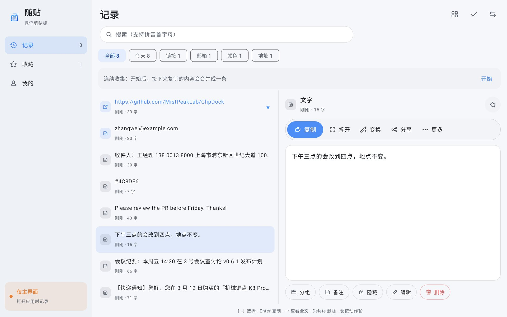</td>
<td width="50%">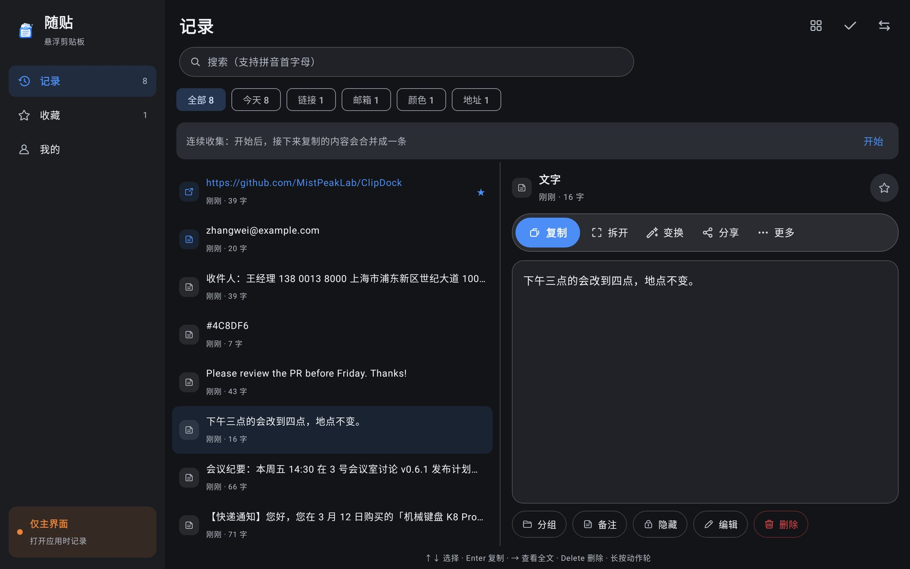</td>
</tr>
<tr>
<td align="center" colspan="2"><b>详情视图</b>　左边列表、右边全文，适合看长文；全文可以直接选中一部分复制</td>
</tr>
<tr>
<td width="50%">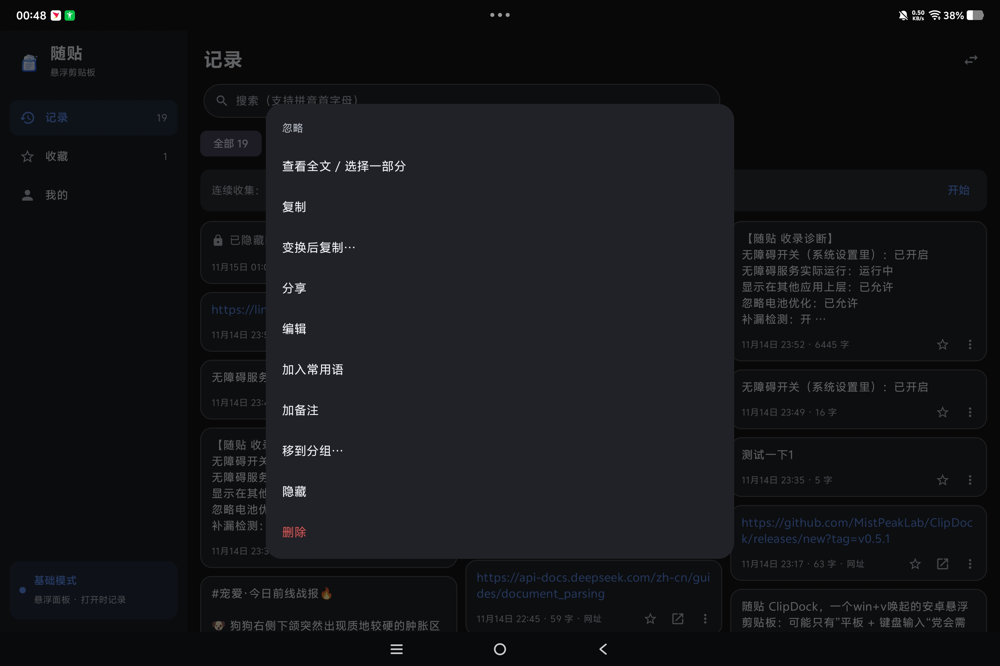</td>
<td width="50%">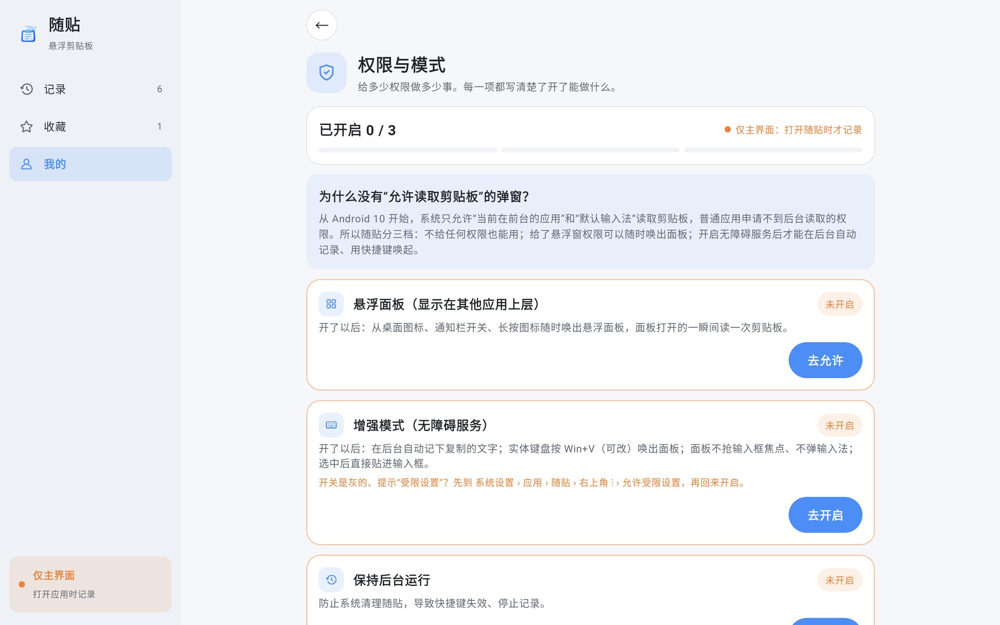</td>
</tr>
<tr>
<td align="center"><b>“更多”菜单</b><br>全部动作分“使用 / 整理”两组，什么都找得到</td>
<td align="center"><b>权限与模式</b><br>开了几项一目了然，每一项都写清楚开了能做什么</td>
</tr>
</table>

**手机上也能用**：底部导航、两列卡片，详情从底部弹出；悬浮面板是能拖动、能缩放的小窗，不占半屏（第三张：搜“会”，命中的字标黄）。

<p align="center">
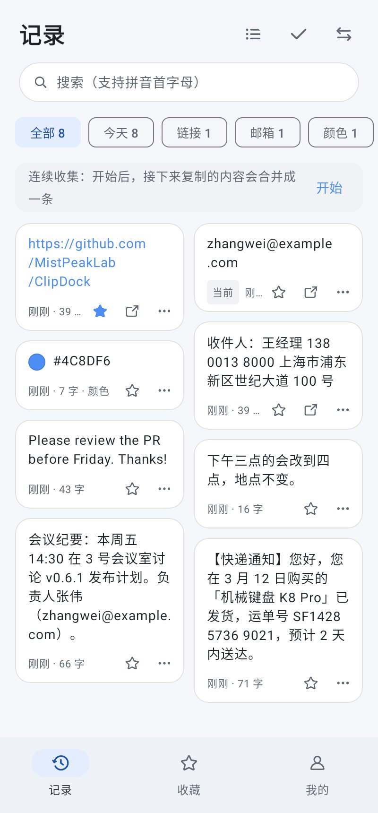
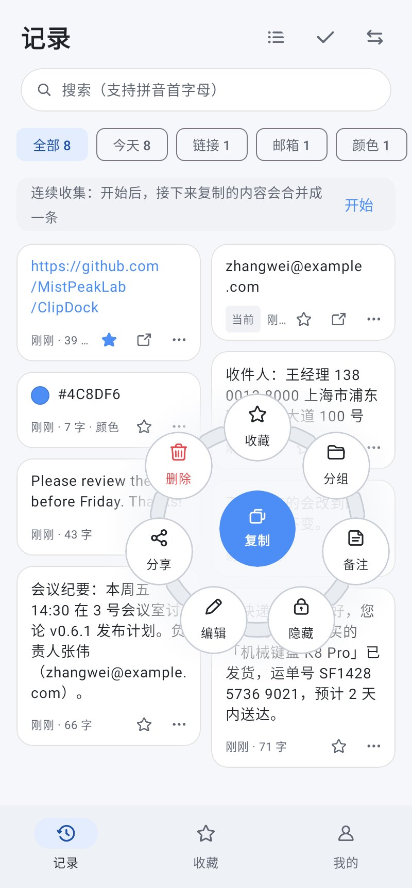
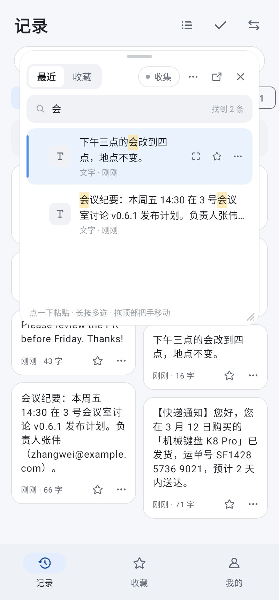
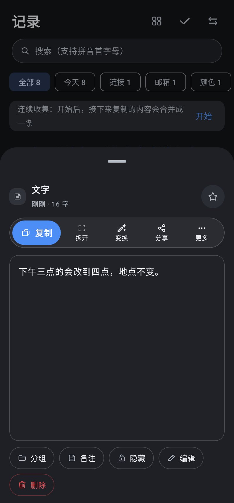
</p>

---

## 0.7 新增：看板娘悬浮球、文库、通知栏与小部件

### 卡卡：住在屏幕边上的悬浮球


没有键盘、只用手指的时候，点屏幕边上的卡卡就能打开面板。她是一只文件夹猫娘：复制时接住卡片，粘贴时把卡片抛出去，查看隐藏内容前捂上眼睛，暂停记录时去睡觉；没人理她时会随机招手、打哈欠、蹦一下。

- **点一下**：打开 / 关闭面板；**按住拖动**：换位置，松手贴到左边或右边（也可以设成“随意摆放”）
- **长按**：环形控制台，手指滑到一项松手就执行——**最近 / 收藏**（再滑到某一条，直接贴进输入框）、暂停 / 恢复记录、今日隐藏、打开随贴
- 3 秒不动就缩到屏幕边探头、变淡；**看视频、玩游戏全屏时自动藏起来**
- 不想要看板娘，也可以换成一个圆形小图标；大小、收起时的透明度都能调
- 开着增强模式时不需要悬浮窗权限；没开时用悬浮窗权限 + 前台服务，开机后自动恢复

<p align="center">
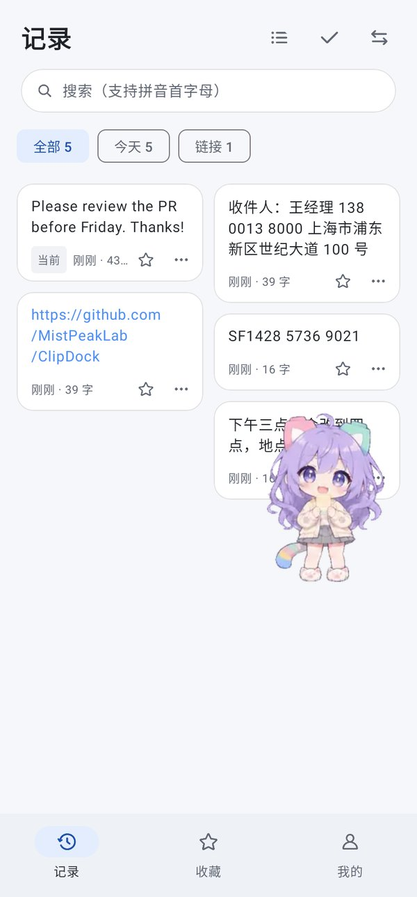
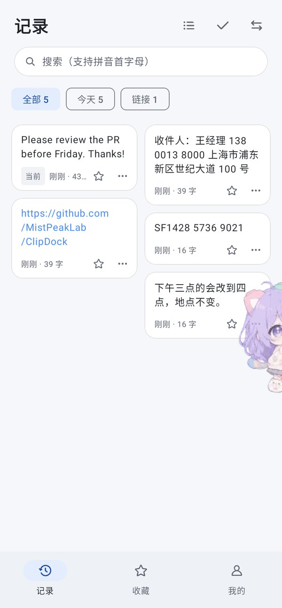
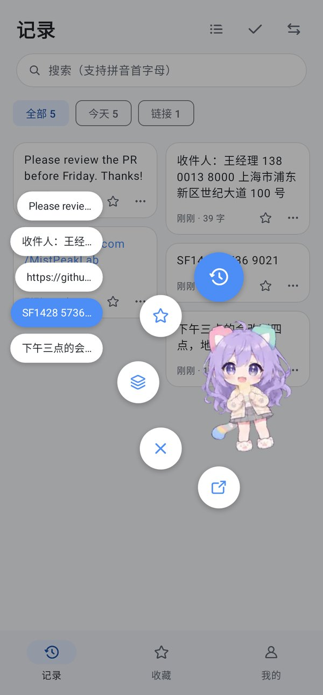
</p>

### 文库：长文字放这里，用时挑一段贴

读书摘抄、写作素材、合同条款、常用的大段说明……这些东西不适合混在剪贴板记录里，又经常只需要其中一段。文库按**文集**整理，每篇可以记下书名、作者和链接。

- **存进来**：在任意应用里选中文字 › **存进文库**；分享文字给随贴时选“存进文库”；记录的 ⋮ 菜单 › 存进文库；或者**导入 txt / md 文件**（可多选，GBK 编码的老文件也不会乱码）
- **读**：大字号阅读，选中一段后可以 复制 / 存为记录 / 加入常用语；几十万字的长篇也能流畅滚动
- **搜**：跨篇章全文搜索，结果显示命中前后的文字，点一下跳到那里并标黄
- **贴**：悬浮面板多了一个“文库”标签，打开一篇就是**拆开挑选**，选中哪段贴哪段；长篇分块翻页。可选在后面附上“——《书名》作者”

<p align="center">
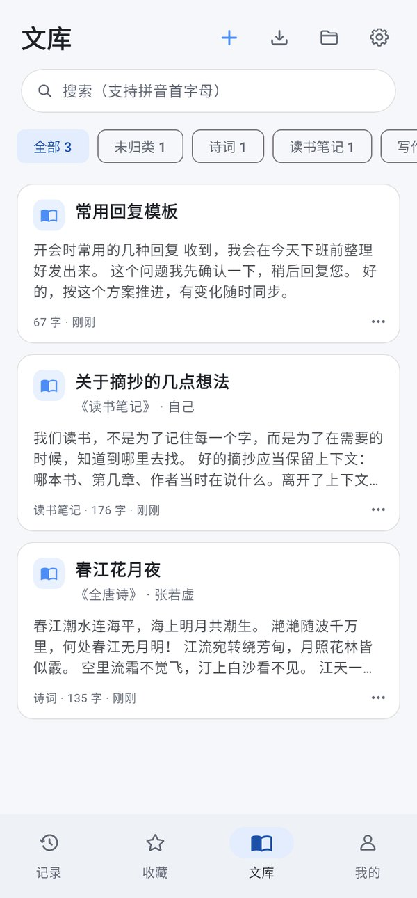
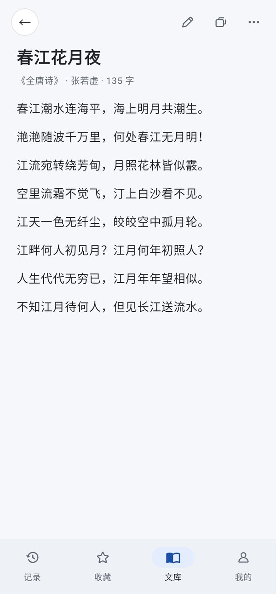
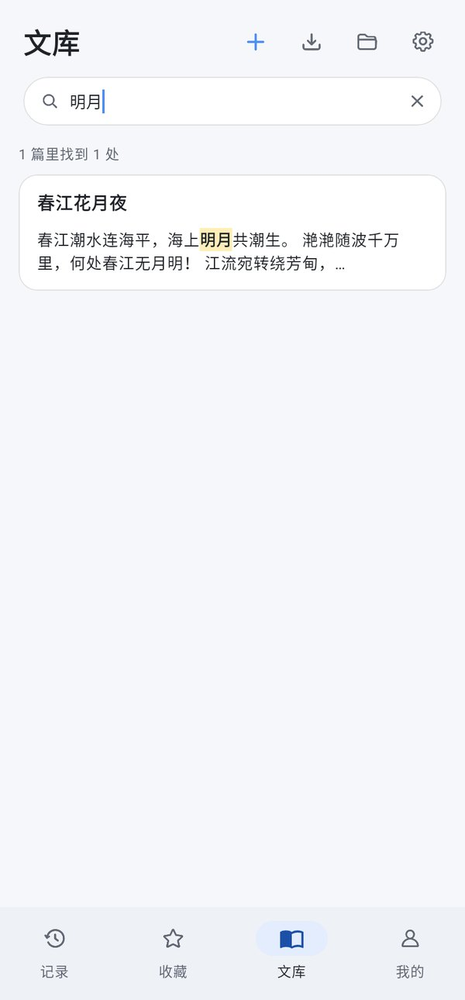
</p>

<p align="center">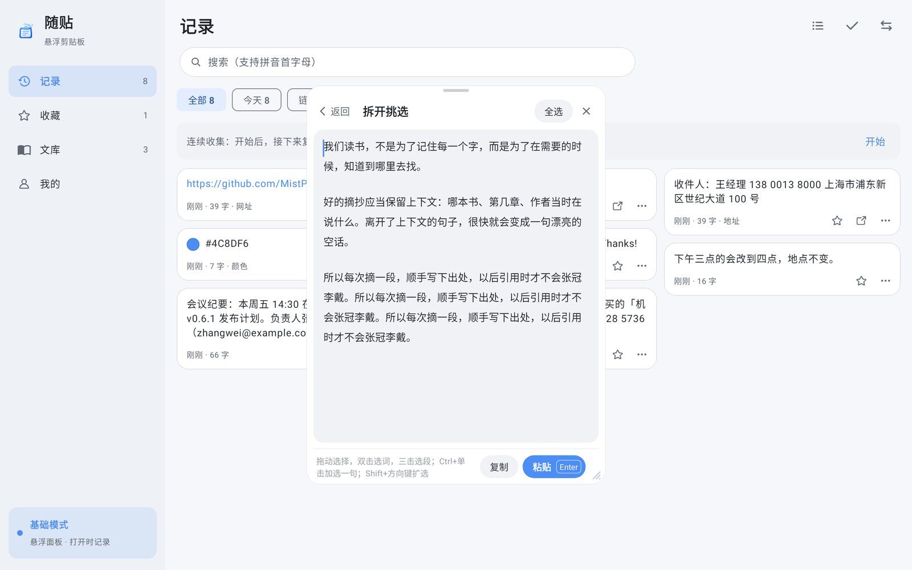</p>

### 通知栏与桌面小部件

不打开随贴也能拿到最近复制的内容：

- **常驻通知**（可选）：下拉通知栏，最近 3 条各有一个按钮，点一下就复制；隐藏的内容不会出现在通知里，锁屏上也只显示“随贴”
- **桌面小部件**：显示最近复制的，也可以选收藏或某个分组；点一条就复制，隐藏的条目先验证身份；跟系统壁纸取色，深浅色都有

<p align="center">
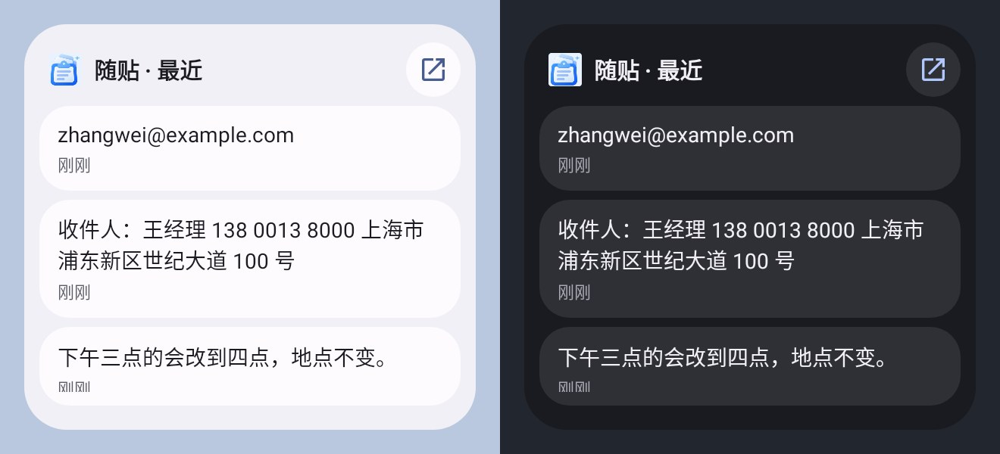
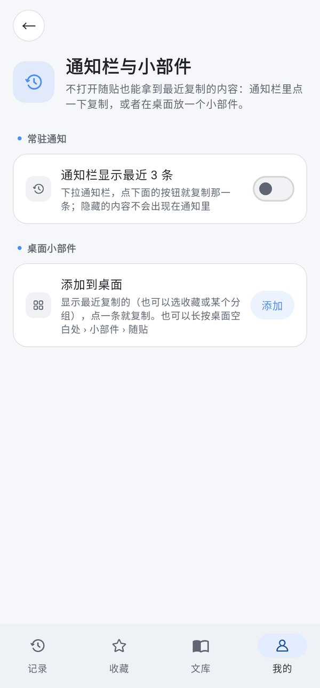
</p>

---

## 功能一览

**收**
- 在别的应用里 **Ctrl+C / Ctrl+X**、点了“复制”按钮、弹出“已复制”提示，都会自动记一条；实在没察觉到的，切换应用或解锁屏幕时再补记一次
- **不开无障碍也能存**：选中文字后在菜单里点 **“存到随贴”**（有的应用收在 ⋮ 里），或者“分享”给随贴
- **连续收集**：打开后，接下来复制的内容自动合并成一条，适合从多处摘抄
- **按应用规则**：某些应用里复制的可以设成“不记录”或“自动隐藏”；密码管理器、被系统标记为敏感的内容默认不记录
- 重复的内容不会重复记，而是移到最前面

**存**
- 记录存在本机数据库，上限可设到 9999 条，几千条也不卡
- 置顶、常用语、**分组**统一放在“收藏”页；置顶的不受条数上限影响，“清空”也不会删
- **回收站**：删除的、超出上限的记录保留 30 天；刚删掉时屏幕上方有 5 秒“撤销”
- **导入 / 导出 / 自动备份**：可以设密码加密，自动备份按天或按周写到你选的文件夹（可以选网盘同步目录）
- **文库**：长文字按文集整理，导入 txt / md，全文搜索，粘贴时挑其中一段

**找**
- 面板弹出后**直接打字就搜**，不用先点搜索框；命中的字会标黄
- **拼音搜索**：`kuaidi`、`kdtz` 都能找到“快递通知”；空格分隔多个关键词
- 按 今天 / 链接 / 类型 / 来源应用 筛选；每条可加**备注**，备注也能搜到

**贴**
- **多条合并**：选几条，`Ctrl+V` 一次贴进去；分隔可选换行 / 空一行 / 空格 / 直接连接
- **依次粘贴**：多选后每粘贴一次自动换到下一条，填表时不用来回切换
- **拆开挑选**、**变换后粘贴**（19 种，不改原记录）、**按行拆分 / 合并**
- **内容类型快捷动作**：网址打开、电话拨号、地址看地图
- **粘贴前清理格式**：去掉零宽字符、行尾空格、多余空行

**隐私**
- **隐藏内容**：列表里只显示“已隐藏”，查看或粘贴前验证指纹 / 锁屏密码；内容在本机加密保存，没有锁屏密码时改用应用密码
- **敏感内容识别**：验证码过一会儿自动清除，银行卡号自动隐藏
- 主界面可以禁止截屏

**不打扰**
- 面板**不抢输入框焦点，不弹输入法**；拖动移动，右下角缩放，大小和位置都会记住
- 关闭方式逐项可选：选中后收起 / Esc / 点空白处 / 再按快捷键 / 切换应用
- 多种唤起方式：快捷键、**悬浮球卡卡**、桌面图标（可设为直接弹面板）、通知栏快捷开关；**常驻通知**和**桌面小部件**里点一下直接复制
- **暂停记录**：临时不想被记下来时，在设置或悬浮球的控制台里一键暂停（卡卡会去睡觉），主界面顶部会提示
- **简洁模式**只留记录、搜索、粘贴、收藏；**全能模式**打开全部功能，也可以逐项开关
- 中英文界面，深色 / 浅色主题

<p align="center">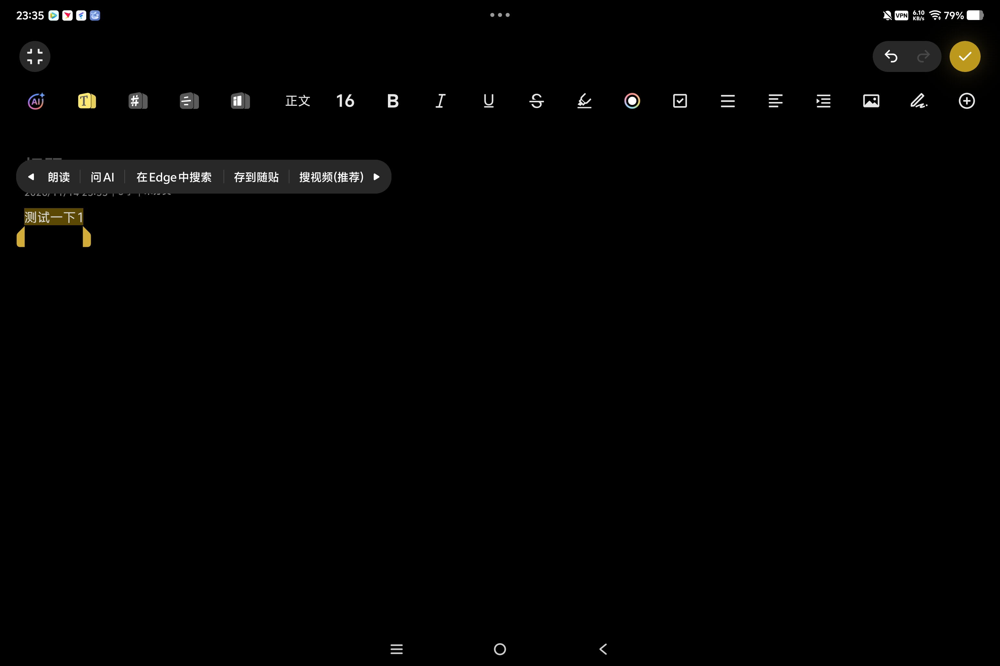</p>

<table>
<tr>
<td width="50%">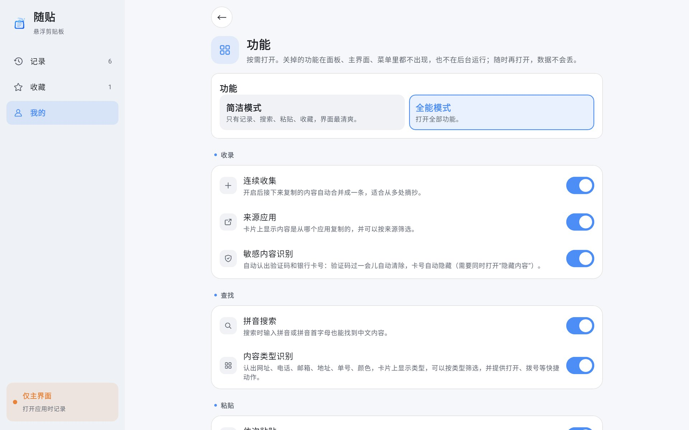</td>
<td width="50%">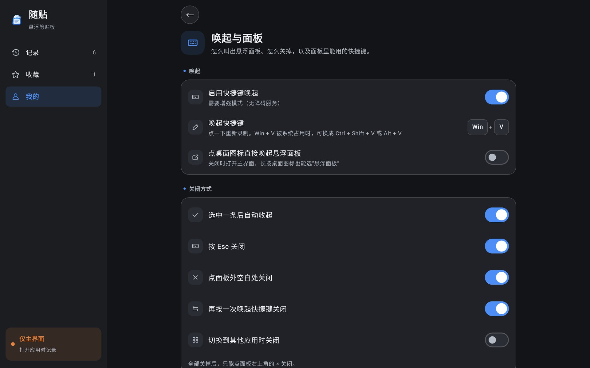</td>
</tr>
<tr>
<td align="center"><b>简洁 / 全能</b><br>也可以逐项开关，关掉的功能在面板和菜单里都不出现</td>
<td align="center"><b>唤起与面板</b><br>快捷键可录制，关闭方式逐项可选</td>
</tr>
<tr>
<td width="50%">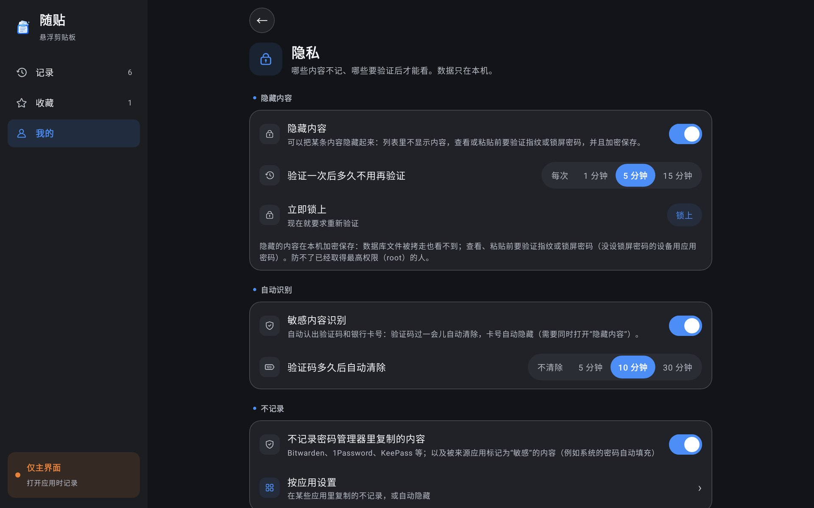</td>
<td width="50%">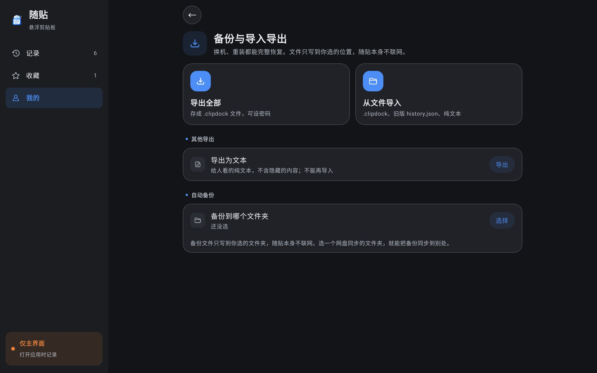</td>
</tr>
<tr>
<td align="center"><b>隐私</b><br>隐藏内容加密保存，按应用设规则</td>
<td align="center"><b>备份与导入导出</b><br>可以设密码，自动备份按天或按周</td>
</tr>
<tr>
<td width="50%">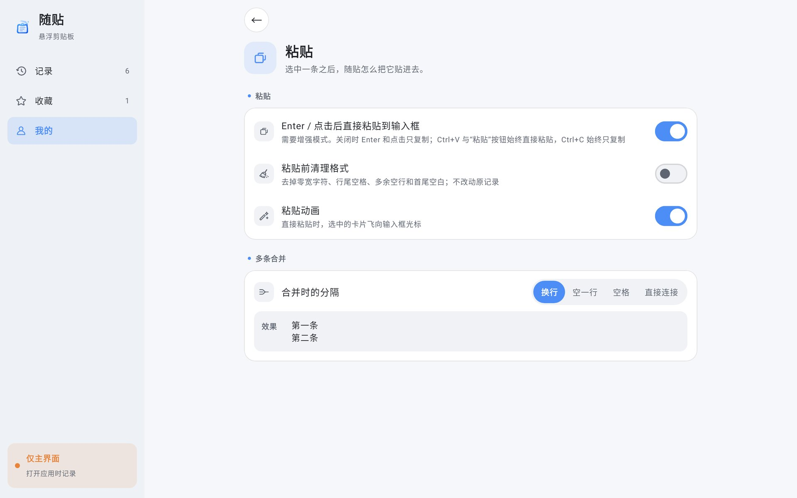</td>
<td width="50%"></td>
</tr>
<tr>
<td align="center"><b>粘贴</b><br>多条合并的分隔旁边直接显示合并效果</td>
<td align="center"><b>回收站</b><br>保留 30 天，随时恢复</td>
</tr>
</table>

---

## 关于权限：为什么要开无障碍？

这是大家问得最多的问题，答案有点长，但值得说清楚。

从 Android 10 开始，系统规定**只有前台应用和默认输入法**能读剪贴板。确实存在一个“后台读剪贴板”的权限，但它只发给系统应用——普通应用写进清单也拿不到。所以**世界上不存在“允许随贴读取剪贴板”这种授权弹窗**。

随贴的做法是分三档，你给多少权限，它就做多少事：

| 档位 | 需要什么 | 能做什么 |
|---|---|---|
| **仅主界面** | 什么都不用 | 打开随贴时读取当前剪贴板，点卡片复制；选中文字“存到随贴”、分享到随贴 |
| **基础模式** | 显示在其他应用上层 | 随时唤出悬浮面板，面板打开时读一次剪贴板 |
| **增强模式** | 无障碍服务 | 后台自动记录复制的文字、快捷键唤起、面板不抢焦点、可选自动粘贴 |

增强模式的原理：检测到你“可能复制了”的那一刻，随贴弹出一个 1 像素的透明窗口，拿到焦点的瞬间读一次剪贴板，随即消失，整个过程不到半秒。

> **开关是灰的、提示“受限设置”？**
> 这是安卓对非商店安装应用的保护。到 系统设置 › 应用 › 随贴 › 右上角 ⋮ › **允许受限设置**，再回去开启即可。

> **复制了，却没记下来？**
> 安卓没有“剪贴板变了”的通知，随贴只能靠各种迹象判断你刚复制过，个别应用、个别机型上会漏。
> 到 **我的 › 收录诊断** 能看到每一次读取是被什么触发的、结果如何；点“复制诊断信息”发到 [Issues](https://github.com/MistPeakLab/ClipDock/issues)，我来适配。诊断信息里没有你复制的内容。
> 在那之前，用“存到随贴”或分享，一定能存进来。

<p align="center">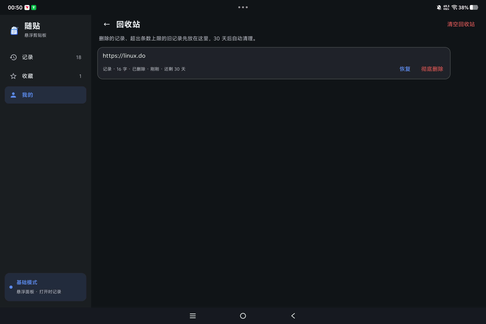</p>

> **主界面提示“增强模式已被系统停止”？**
> 系统为了省电把无障碍服务清掉了。到无障碍设置里把随贴关掉再重新打开；再到 **权限与模式** 里允许“保持后台运行”，可以减少再次发生。

> **复制时弹出“随贴 已粘贴自剪贴板”？**
> 这是系统的隐私提示，可以在 系统设置 › 隐私 › 显示剪贴板访问通知 中关闭。

---

## 隐私

- 应用**没有申请联网权限**，数据从物理上就出不去
- 记录保存在应用私有目录的数据库里；隐藏的内容加密保存（密钥在系统密钥库里）
- 只记录文字，不记录图片和文件
- 卸载即清空

---

## 安装

1. 到 [Releases](https://github.com/MistPeakLab/ClipDock/releases/latest) 下载最新的 apk，在平板上安装（覆盖安装即可升级，记录不会丢）
2. 打开随贴，跟着首次引导选使用方式和“简洁 / 全能”，按需开启悬浮窗权限和无障碍服务
3. 建议同时允许“保持后台运行”，防止系统清理导致快捷键失效
4. 在别的应用里复制几段文字，按 `Win + V` 试试

> `Win + V` 按了没反应？可能被系统占用了，到 **我的 › 唤起与面板** 换一个快捷键。

**系统要求**：Android 14 及以上（已在 Android 17 平板上实测）。

> **校验安装包**：正式版均使用同一个证书签名，SHA-256 指纹为
> `64:09:B1:17:63:B5:28:73:2C:9C:DE:FE:E5:8C:58:2B:AD:1B:22:F1:92:F0:94:E8:57:33:94:E7:FF:22:B1:05`
> 可用 `apksigner verify --print-certs ClipDock-vX.Y.Z.apk` 核对。指纹不一致的安装包不是官方发布的。

---

## 更新记录

- **v0.7.0**　看板娘悬浮球卡卡（长按环形控制台）、文库（文集、导入 txt / md、全文搜索、面板里拆开挑选）、桌面小部件、常驻通知、暂停记录
- **v0.6.2**　悬浮面板重做：和主界面同一套样式，搜索命中的字标黄，变换后粘贴改成面板内的一页；手机上也是悬浮小窗
- **v0.6.1**　主界面重做：动作条 / 动作轮分工、变换弹窗、详情视图，设置各页逐页重新设计
- **v0.6.0**　改用数据库、回收站、分组、备份、隐藏内容、依次粘贴、变换后粘贴、简洁 / 全能模式、中英文界面

完整内容见 [CHANGELOG.md](CHANGELOG.md)。

---

## 从源码构建

不需要 Android Studio，命令行工具就够了。每次推送到 `main`，GitHub Actions 都会自动编译一个调试版 apk，可以在 [Actions](https://github.com/MistPeakLab/ClipDock/actions) 页面下载。

**环境**：JDK 17 · Android SDK（platform 36、build-tools 36.0.0）· Gradle 由项目自带的 Wrapper 自动下载

```powershell
git clone https://github.com/MistPeakLab/ClipDock.git
cd ClipDock
# 在 local.properties 中写好 SDK 路径，例如：sdk.dir=E\:\\Android\\sdk
.\gradlew.bat assembleDebug     # 调试包：app\build\outputs\apk\debug\
.\gradlew.bat assembleRelease   # 正式包：app\build\outputs\apk\release\
.\gradlew.bat testDebugUnitTest # 单元测试
```

<details>
<summary>正式签名与其他说明</summary>

在项目根目录放一个 `keystore.properties`（已被 `.gitignore` 排除）：

```
storeFile=你的密钥库路径.jks
storePassword=…
keyAlias=…
keyPassword=…
```

没有这个文件时，`assembleRelease` 会自动退回调试签名，方便自己编译测试。

项目路径含中文时，Android 构建工具默认会拒绝，`gradle.properties` 里已用 `android.overridePathCheck=true` 关闭这项检查。

</details>

**技术栈**：Kotlin · Jetpack Compose（主界面）· 原生 View（悬浮面板）· 无障碍服务 · SQLite · 零第三方依赖（除 AndroidX）

<details>
<summary>代码结构</summary>

```
app/src/main/java/com/mistpeaklab/clipdock/
├── ClipService.kt          无障碍服务：后台记录（触发判断 + 焦点探针）、全局快捷键、自动粘贴
├── PanelHost.kt            按权限档位决定面板怎么显示；剪贴板读写
├── PanelController.kt      悬浮面板：列表、搜索、多选、变换页、拖动缩放、键盘操作
├── LibraryStore.kt / LibraryPage.kt / LibrarySaveActivity.kt  文库：存储、主界面文库页（阅读、编辑、搜索）、“存进文库”小弹窗
├── ClipWidget.kt           桌面小部件、点小部件 / 通知里的一条复制
├── floatball/              悬浮球：卡卡的动画（动画 WebP）、贴边与拖动、环形控制台、前台服务与常驻通知
├── PiecePicker.kt          拆开挑选：像 Word 一样自由选择文字（自绘选区、光标、手柄）
├── PasteFly.kt             粘贴动画：卡片飞向输入框光标
├── PasteQueue.kt / Undo.kt 依次粘贴、删除后撤销（屏幕上方的小条）
├── ClipStore.kt            记录、常用语、收藏的读写入口
├── MainActivity.kt         主界面框架与主题
├── RecordsPage.kt          记录 / 收藏页：卡片墙、详情视图、动作条、动作轮
├── TransformDialog.kt      主界面的变换弹窗
├── SettingsPage.kt / PermissionsPage.kt / PrivacyBackupPages.kt / TrashPage.kt / DiagPage.kt
├── Features.kt / Prefs.kt  简洁 / 全能与逐项开关；设置项与快捷键
├── Unlock.kt               隐藏内容的身份验证
├── AutoBackup.kt           自动备份
├── SaveTextActivity.kt     选中文字“存到随贴”、分享到随贴
├── LauncherActivity.kt / PanelTileService.kt  桌面图标入口、通知栏快捷开关
├── data/                   数据库、加密保险箱、备份格式、旧版数据迁移
└── util/                   内容识别、拼音、搜索与高亮、19 种文字变换（纯 Kotlin，有单元测试）
```

</details>

---

## 不打算做的事

有些功能很诱人，但会让随贴变成另一个东西，所以刻意不做：

- **云同步、多设备互传**：违背“不联网”这条底线
- **图片和文件**：复杂度翻好几倍，而这里的场景几乎全是文字
- **AI 改写、翻译**：那是另一个产品

如果你觉得某个功能真的该有，欢迎提 Issue，理由能说服“它让挑一条贴进去更快”就行。

---

## English

**ClipDock** is a floating **clipboard history manager for Android tablets with a physical keyboard** — think Windows `Win + V`, but for Android.

On Android, `Ctrl + V` only pastes the latest copy. Reaching older items means summoning the on-screen keyboard, which covers half the screen even though you already have a real keyboard. ClipDock fixes that:

- **Records everything you copy** in the background (via an accessibility service; Android 10+ forbids background clipboard access for normal apps)
- **`Win + V` (customizable) opens a floating panel** that never steals focus from your text field and never pops up the soft keyboard
- **Type to search** (with Pinyin: `kuaidi` or `kdtz` finds 快递通知), matches highlighted; `↑ ↓ Enter` or `1–9` to paste, `Tab` for favourites
- **Desktop-style multi-select**: `Ctrl + A`, `Ctrl + click`, `Shift + click`, then `Ctrl + V` pastes them merged, straight into the input field
- **Paste just part of an item**: press `→` to expand a long item and select freely like in Word, then `Enter` pastes only that part
- **Transform before pasting**: remove line breaks, change case, space out CJK and Latin text, strip link tracking parameters, extract numbers / links / e-mails and more; the original stays untouched
- **Paste queue**: select several items and each paste gives you the next one — handy for filling forms
- **Collect mode**, **content-type actions**, **hidden items** (encrypted, revealed after fingerprint / screen-lock verification), **trash** with 30-day recovery, **groups**, **notes**, **encrypted backups**
- **Kaka, the floating bubble**: a folder cat-girl on the edge of the screen — tap for the panel, long-press for a radial menu (slide to a recent or starred item to paste it, pause recording, hide for today); she catches what you copy, throws what you paste, and hides when a video or game goes full screen
- **Library** for long texts: collections, import txt / md (GBK too), full-text search, and paste just the paragraph you need from the panel
- **Home-screen widget** and an optional **persistent notification**: tap a recent item to copy it
- **Simple / Full modes**: start with just history, search, paste and favourites, turn on the rest whenever you like
- **Fully offline**: no `INTERNET` permission, text only, stored locally

Requires Android 14+. The UI is available in Chinese and English, in light and dark themes. See [CHANGELOG.md](CHANGELOG.md) for release notes.

---

## 开源协议

[MIT](LICENSE) © 2026 MistPeakLab

## 🔗 友情链接

[LINUX DO](https://linux.do/) —— 真诚分享、友好讨论的技术社区，本项目的交流与反馈也发布于此

---

<div align="center">

**随手复制，随时贴。**

</div>
