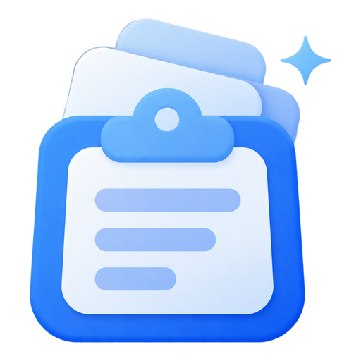
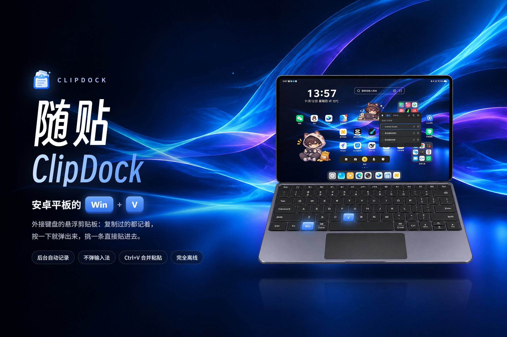
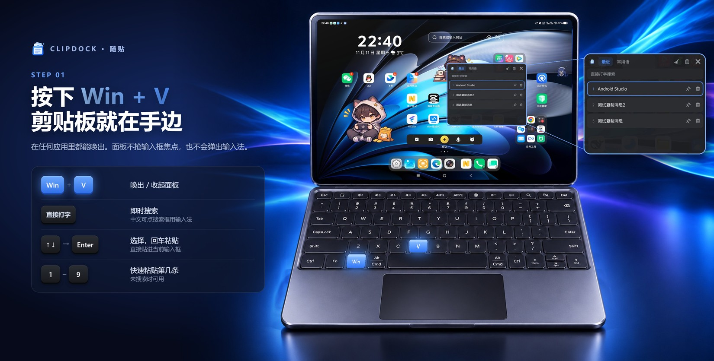
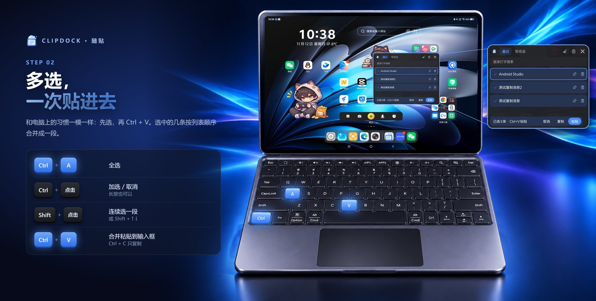
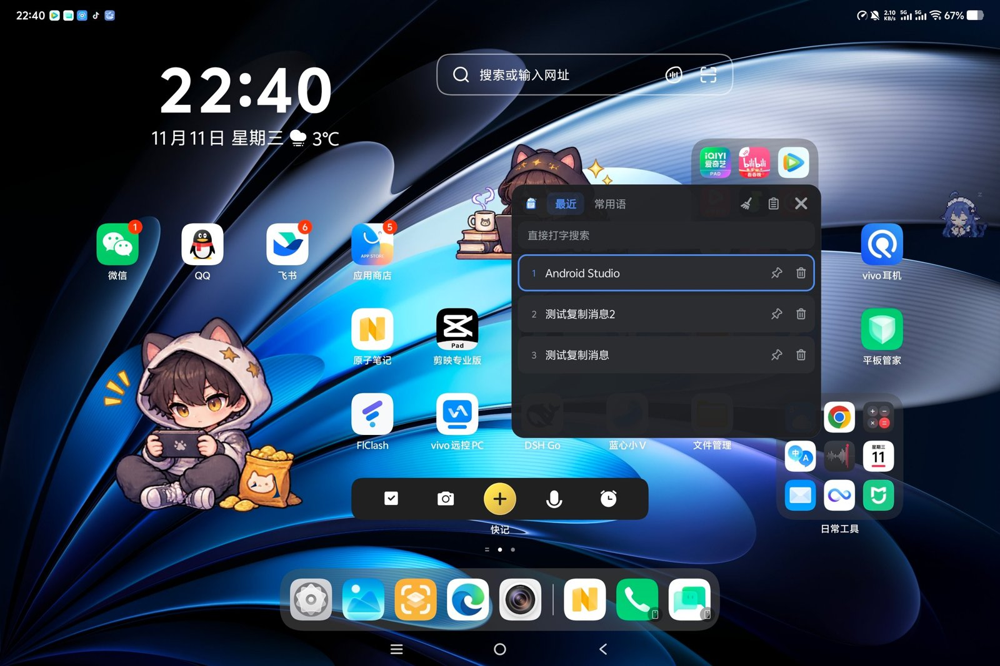
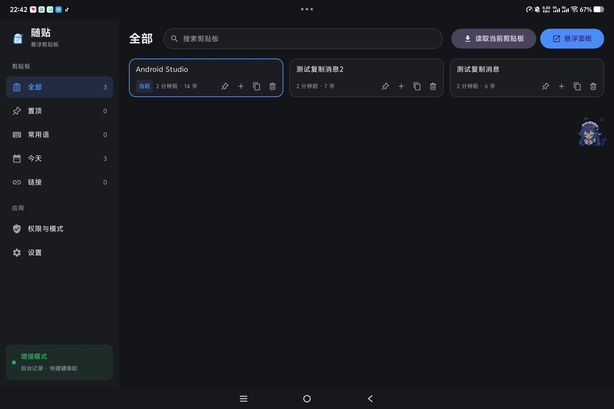
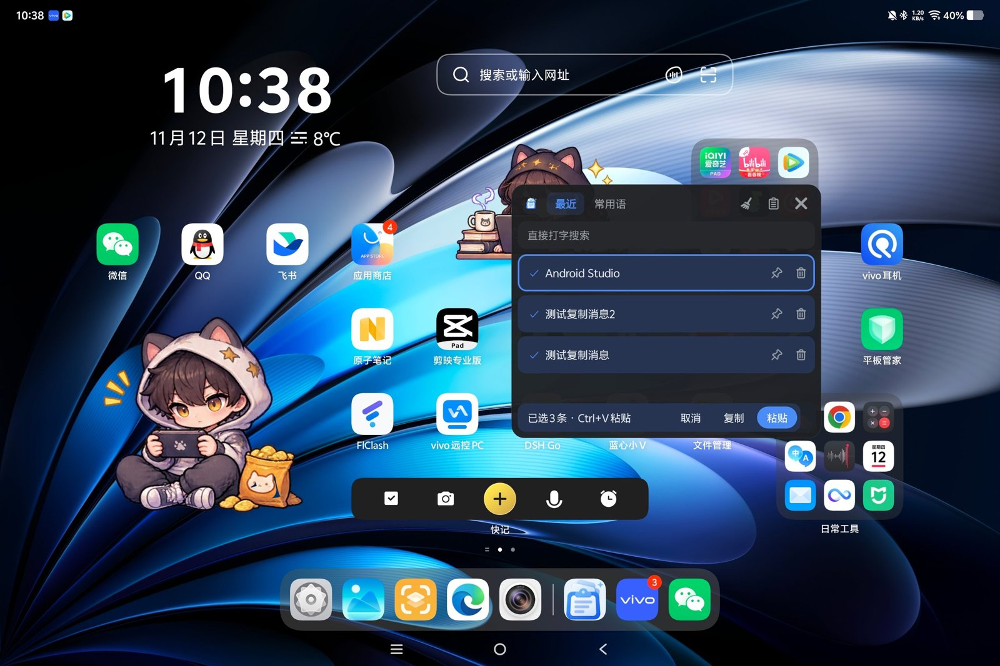
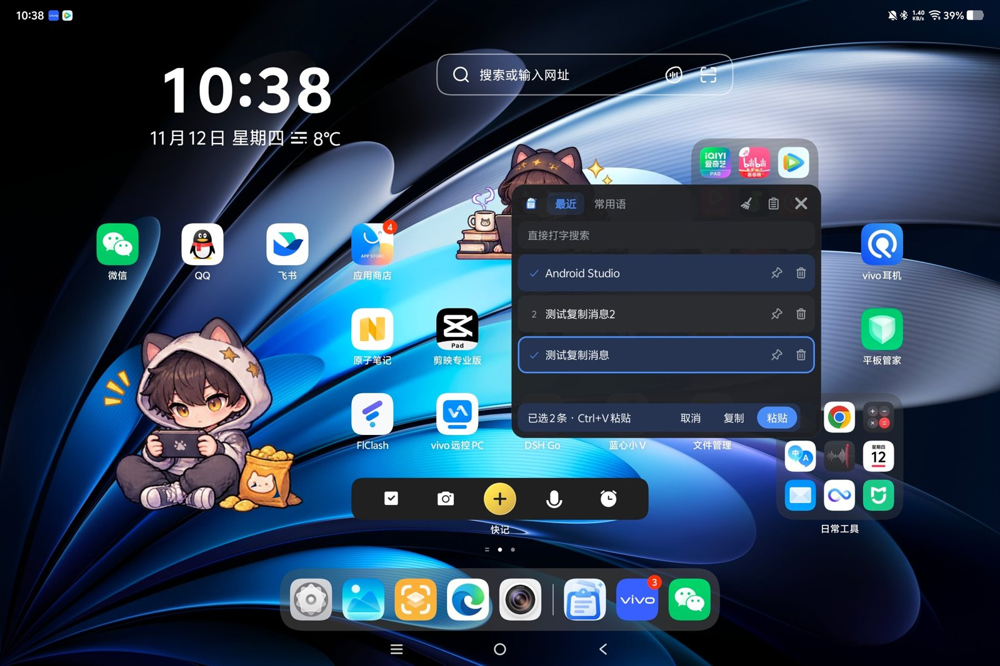
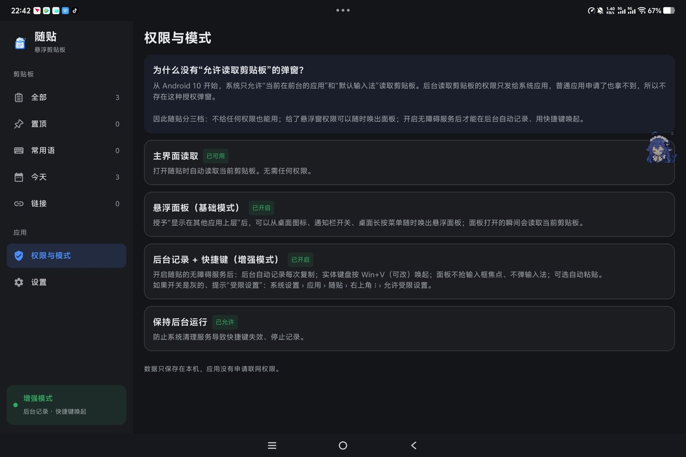
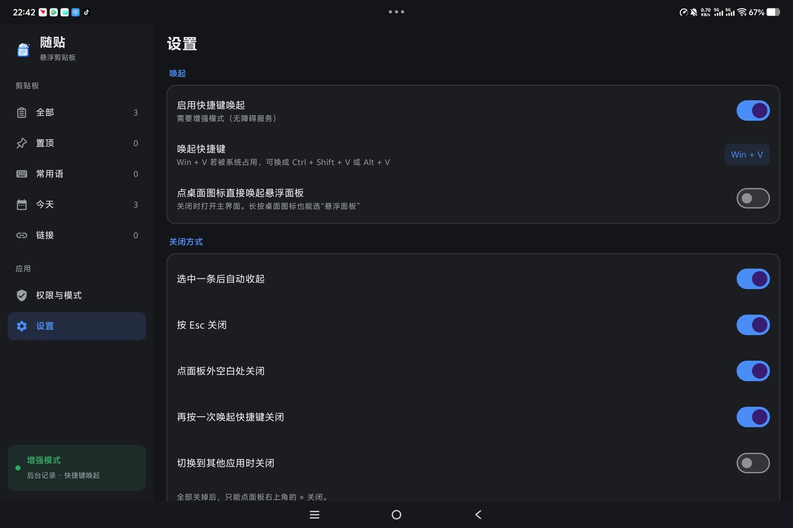

<div align="center">



# 随贴 ClipDock

**给接了键盘的安卓平板，补上它一直缺的那个 Win + V。**

一款面向 **Android 平板 + 实体键盘** 的悬浮剪贴板历史管理器（Clipboard Manager）<br>
后台自动记录复制内容 · 快捷键唤起悬浮面板 · 多选合并粘贴 · 完全离线


[](https://github.com/MistPeakLab/ClipDock/actions/workflows/build.yml)

[简体中文](#故事是这样的) · [English](#english)



</div>

---

## 故事是这样的

你给平板配了蓝牙键盘，打字速度一下子回到了电脑时代。
直到你想粘贴**上一条**复制的内容——

Ctrl+V 只认最新的那一条。想要更早的，就得把输入法请出来，翻到剪贴板，再看它愿不愿意出来。
那块软键盘“哗”地升起来，把半个屏幕盖住。你明明有一把实体键盘，此刻却被迫回到手机的姿势。

Windows 早就有 Win + V，macOS 的剪贴板工具多得能开一条街，安卓平板这块地方却一直空着。

**随贴就是来填这块空地的。** 它安安静静待在后台，记下你复制过的每一段文字。需要时按一下 Win + V，面板浮出来，挑一条，回车，完事——输入框的光标还在原处，输入法一下都没动。

它不做云同步，不做 AI 改写，不做截图识别。**它只做剪贴板，并且努力把这一件事做好。**

---

## 两个快捷键就够了

<p align="center"></p>

<p align="center"></p>

---

## 长这样

<table>
<tr>
<td width="50%"></td>
<td width="50%"></td>
</tr>
<tr>
<td align="center"><b>悬浮面板</b><br>Win + V 唤出，直接打字就搜，1–9 快选</td>
<td align="center"><b>主界面</b><br>平板横屏布局：侧边栏分类 + 卡片网格</td>
</tr>
<tr>
<td width="50%"></td>
<td width="50%"></td>
</tr>
<tr>
<td align="center"><b>Ctrl + A 全选</b><br>选中的条目打勾，底部出现操作条</td>
<td align="center"><b>Ctrl + 点击 挑几条</b><br>再按 Ctrl + V，按列表顺序合并后直接贴进输入框</td>
</tr>
<tr>
<td width="50%"></td>
<td width="50%"></td>
</tr>
<tr>
<td align="center"><b>权限与模式</b><br>每一档需要什么、能做什么，写得明明白白</td>
<td align="center"><b>设置</b><br>快捷键可录制，关闭方式逐项可选</td>
</tr>
</table>

<p align="center"><sub>它就是为这种姿势设计的：平板立起来，手留在键盘上。</sub></p>

---

## 它能做什么

### 记下来
- 在别的应用里 **Ctrl+C / Ctrl+X**、点了“复制”按钮、弹出“已复制”提示，都会自动记一条
- 重复的内容不会重复记，而是移到最前面
- 想长期留着的可以**置顶**，不受条数上限影响，“清空”也不会删掉它

### 找得到
- **直接打字就能搜索**：面板弹出后敲几个字母立刻过滤，不用先点搜索框；要打中文就点一下搜索框
- 主界面按 **全部 / 置顶 / 常用语 / 今天 / 链接** 分类，配合搜索
- 当前系统剪贴板里的那一条会标出“当前”

### 贴得快
| 按键 | 作用 |
|---|---|
| `Win + V` | 唤出 / 收起面板（可改成任意组合键） |
| 直接打字 | 搜索 |
| `↑` `↓` `Enter` / 点击 | 选择并粘贴 |
| `1` – `9` | 快速粘贴第几条（未搜索时） |
| `Tab` | 切换“最近 / 常用语” |
| `Ctrl + A` | 全选 |
| `Ctrl + 点击` / 长按 | 加选 / 取消 |
| `Shift + 点击` / `Shift + ↑↓` | 连续选择一段 |
| `Ctrl + V` | 粘贴到输入框，选了多条就按列表顺序合并成一段 |
| `Ctrl + C` | 只复制，不粘贴 |
| `Ctrl + P` / `Delete` | 置顶 / 删除 |
| `Esc` | 取消选择 → 清空搜索 → 关闭 |

快捷键和电脑上的习惯保持一致：`Ctrl+V` 是“贴进去”，`Ctrl+C` 是“拿走”。增强模式下内容会直接粘进当前输入框，不用关掉面板再按一次。

### 不打扰
- 面板**不抢输入框焦点，不弹输入法**
- 标题栏拖动移动，**右下角拖动缩放**，大小和位置都会记住
- 关闭方式五项独立开关：选中后收起 / Esc / 点空白处 / 再按快捷键 / 切换应用

### 一些小心思
- **常用语**：邮箱、地址、固定回复放这里，永不过期，可编辑、可排序，面板里按 Tab 就能切过去
- **粘贴前清理格式**：去掉零宽字符、行尾空格、多余空行，从网页复制的内容终于干净了（不改动原记录）
- **多条合并**：Ctrl+A 或 Ctrl+点击选几条，Ctrl+V 一次贴进去；分隔可选换行 / 空一行 / 空格 / 直接连接
- **三种唤起方式**：快捷键、桌面图标（可设为直接弹面板）、通知栏快捷开关

---

## 关于权限：为什么要开无障碍？

这是大家问得最多的问题，答案有点长，但值得说清楚。

从 Android 10 开始，系统规定**只有前台应用和默认输入法**能读剪贴板。确实存在一个“后台读剪贴板”的权限，但它只发给系统应用——普通应用写进清单也拿不到。所以**世界上不存在“允许随贴读取剪贴板”这种授权弹窗**。

随贴的做法是分三档，你给多少权限，它就做多少事：

| 档位 | 需要什么 | 能做什么 |
|---|---|---|
| **仅主界面** | 什么都不用 | 打开随贴时读取当前剪贴板，点卡片复制 |
| **基础模式** | 显示在其他应用上层 | 随时唤出悬浮面板，面板打开时读一次剪贴板 |
| **增强模式** | 无障碍服务 | 后台自动记录每次复制、快捷键唤起、面板不抢焦点、可选自动粘贴 |

增强模式的原理：检测到你“可能复制了”的那一刻，随贴弹出一个 1 像素的透明窗口，拿到焦点的瞬间读一次剪贴板，随即消失，整个过程不到半秒。

> **开关是灰的、提示“受限设置”？**
> 这是安卓对非商店安装应用的保护。到 系统设置 › 应用 › 随贴 › 右上角 ⋮ › **允许受限设置**，再回去开启即可。

> **复制时弹出“随贴 已粘贴自剪贴板”？**
> 这是系统的隐私提示，可以在 系统设置 › 隐私 › 显示剪贴板访问通知 中关闭。

---

## 隐私

- 应用**没有申请联网权限**，数据从物理上就出不去
- 历史记录只保存在应用私有目录的一个 JSON 文件里
- 只记录文字，不记录图片和文件
- 卸载即清空

---

## 安装

1. 到 [Releases](https://github.com/MistPeakLab/ClipDock/releases) 下载最新的 apk，在平板上安装
2. 打开随贴，进入 **权限与模式**，按需开启悬浮窗权限和无障碍服务
3. 建议同时允许“保持后台运行”，防止系统清理导致快捷键失效
4. 在别的应用里复制几段文字，按 `Win + V` 试试

> `Win + V` 按了没反应？可能被系统占用了，到 设置 › 唤起快捷键 换成 `Ctrl + Shift + V` 或 `Alt + V`。

**系统要求**：Android 15 及以上（已在 Android 17 平板上实测）。
> **校验安装包**：正式版均使用同一个证书签名，SHA-256 指纹为
> `64:09:B1:17:63:B5:28:73:2C:9C:DE:FE:E5:8C:58:2B:AD:1B:22:F1:92:F0:94:E8:57:33:94:E7:FF:22:B1:05`
> 可用 `apksigner verify --print-certs ClipDock-vX.Y.Z.apk` 核对。指纹不一致的安装包不是官方发布的。

---

## 从源码构建

不需要 Android Studio，命令行工具就够了。

```bash
git clone https://github.com/MistPeakLab/ClipDock.git
cd ClipDock
```

每次推送到 `main`，GitHub Actions 都会自动编译一个调试版 apk，可以在 [Actions](https://github.com/MistPeakLab/ClipDock/actions) 页面下载。

**环境**
- JDK 17
- Android SDK（platform 36、build-tools 36.0.0、platform-tools）
- Gradle 由项目自带的 Wrapper 自动下载

```powershell
# 在 local.properties 中写好 SDK 路径，例如：
# sdk.dir=E\:\\Android\\sdk

.\gradlew.bat assembleDebug     # 调试包：app\build\outputs\apk\debug\
.\gradlew.bat assembleRelease   # 正式包：app\build\outputs\apk\release\
```

> **正式签名**：在项目根目录放一个 `keystore.properties`（已被 `.gitignore` 排除）：
> ```
> storeFile=你的密钥库路径.jks
> storePassword=…
> keyAlias=…
> keyPassword=…
> ```
> 没有这个文件时，`assembleRelease` 会自动退回调试签名，方便自己编译测试。

> 项目路径含中文时，Android 构建工具默认会拒绝，`gradle.properties` 里已用 `android.overridePathCheck=true` 关闭这项检查。

**技术栈**：Kotlin · Jetpack Compose（主界面）· 原生 View（悬浮面板）· 无障碍服务 · 零第三方依赖（除 AndroidX）

### 代码结构

```
app/src/main/java/com/mistpeaklab/clipdock/
├── ClipService.kt       无障碍服务：后台记录（焦点探针）、全局快捷键、自动粘贴
├── PanelController.kt   悬浮面板：搜索、标签、多选、拖动、缩放、键盘操作
├── PanelHost.kt         按权限档位决定面板怎么显示；剪贴板读写
├── ClipStore.kt         历史记录与常用语（本地 JSON）、文字清理
├── Prefs.kt             设置项与快捷键
├── MainActivity.kt      主界面：侧边栏、卡片网格、权限与模式页
├── PhrasesPage.kt       常用语管理
├── SettingsPage.kt      设置页、快捷键录制
├── LauncherActivity.kt  桌面图标 / 长按快捷方式入口
└── PanelTileService.kt  通知栏快捷开关
```

---

## 不打算做的事

有些功能很诱人，但会让随贴变成另一个东西，所以刻意不做：

- **云同步、多设备互传**：违背“不联网”这条底线
- **图片和文件**：复杂度翻好几倍，而这里的场景几乎全是文字
- **AI 改写、翻译**：那是另一个产品
- **常驻悬浮球**：快捷键加通知栏开关已经够了，屏幕上不需要多一个东西

如果你觉得某个功能真的该有，欢迎提 Issue，理由能说服“它让挑一条贴进去更快”就行。

---

## English

**ClipDock** is a floating **clipboard history manager for Android tablets with a physical keyboard** — think Windows `Win + V`, but for Android.

On Android, `Ctrl + V` only pastes the latest copy. Reaching older items means summoning the on-screen keyboard, which covers half the screen even though you already have a real keyboard. ClipDock fixes that:

- **Records everything you copy** in the background (via an accessibility service; Android 10+ forbids background clipboard access for normal apps)
- **`Win + V` (customizable) opens a floating panel** that never steals focus from your text field and never pops up the soft keyboard
- **Type to search**, `↑ ↓ Enter` or `1–9` to paste, `Tab` for saved snippets
- **Desktop-style multi-select**: `Ctrl + A`, `Ctrl + click`, `Shift + click`, then `Ctrl + V` pastes them merged, straight into the input field
- Pinned items, saved snippets, optional text cleanup, resizable panel, tablet-friendly main UI
- **Fully offline**: no `INTERNET` permission, text only, stored locally

Requires Android 15+. The UI is currently Chinese only.

---

## 开源协议

[MIT](LICENSE) © 2026 MistPeakLab

---

<div align="center">

**随手复制，随时贴。**

</div>
